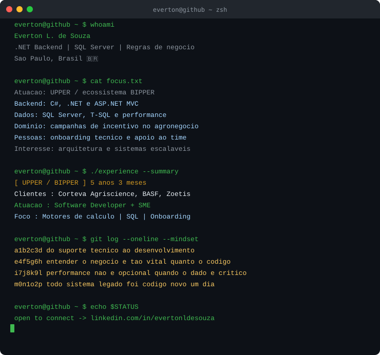

<h1 align="center">
  
  Olá, eu sou o Everton L. de Souza!
</h1>

<h3 align="center">.NET Backend | SQL Server & Business Rules | Agronegócio</h3>

  Tecnologia para resolver problemas reais de negócio 🚀 
  São Paulo, Brasil 🇧🇷

---

## 👨‍💻 Sobre mim

Sou desenvolvedor .NET na **UPPER**, onde atuo nos motores de cálculo do ecossistema **BIPPER**, voltado a campanhas de incentivo no agronegócio. Meu trabalho combina regras de negócio, C# e SQL Server para apoiar sistemas de missão crítica.

Comecei minha trajetória na UPPER em suporte técnico e, em 2022, migrei para desenvolvimento. Essa experiência me ajuda a entender o sistema pela perspectiva de quem o utiliza e a conectar soluções técnicas às necessidades do negócio.

- 🏗️ Projeto e otimizo motores de cálculo e regras de negócio em T-SQL.
- ⚡ Refatoro sistemas legados e otimizo consultas para apoiar a continuidade operacional.
- 🤝 Atuo como **SME**, apoiando o onboarding técnico de desenvolvedores e decisões sobre o produto.
- 🌱 Busco aprofundar meus conhecimentos em arquitetura de software, Clean Architecture e microsserviços.
- 📚 Curso Tecnologia da Informação na UNIVESP (2025–2028).

---

## 🌐 Onde me encontrar

  
  
  
  

---

## 🚀 Projetos em destaque

- [JobRadar](https://github.com/evertonldesouza/JobRadar) — agregador de vagas com API REST, autenticação JWT e Google OAuth.
- [AgroData Engine](https://github.com/evertonldesouza/AgroData_Engine) — dados de commodities agrícolas para apoio à decisão.
- [Hub de Grupos de Estudo](https://github.com/evertonldesouza/hub-grupos-estudo) — plataforma de troca de conhecimento com .NET, PostgreSQL e Clean Architecture.
- [TrendBot](https://github.com/evertonldesouza/TrendBot) — análise preditiva de dados para o mercado de criptoativos.

---

## 🛠️ Stack Principal

**Back-end & Database**

-CC2927?style=for-the-badge&logo=microsoftsqlserver&logoColor=white)

**Front-end**

**Cloud & DevOps**

**Ferramentas**

---

## 💻 Terminal

  

**Em texto:** desenvolvedor .NET e SME na UPPER, com experiência em motores de cálculo, otimização SQL e onboarding técnico. Na empresa desde agosto de 2021.

---

<!-- O tempo na UPPER exibido no terminal é calculado desde agosto de 2021.
     Para mudar a data, edite scripts/update_experience.py; se o vínculo terminar,
     desative o workflow .github/workflows/update-experience.yml e atualize o SVG. -->

## 🐍 Contribuições

  <picture>
    <source media="(prefers-color-scheme: dark)" srcset="https://raw.githubusercontent.com/evertonldesouza/evertonldesouza/output/github-contribution-grid-snake-dark.svg"/>
    <source media="(prefers-color-scheme: light)" srcset="https://raw.githubusercontent.com/evertonldesouza/evertonldesouza/output/github-contribution-grid-snake.svg"/>
    
  </picture>

---

  <i>"A tecnologia mais poderosa é aquela que resolve o problema do negócio com eficiência."</i>

