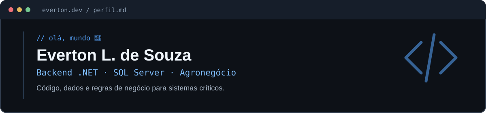
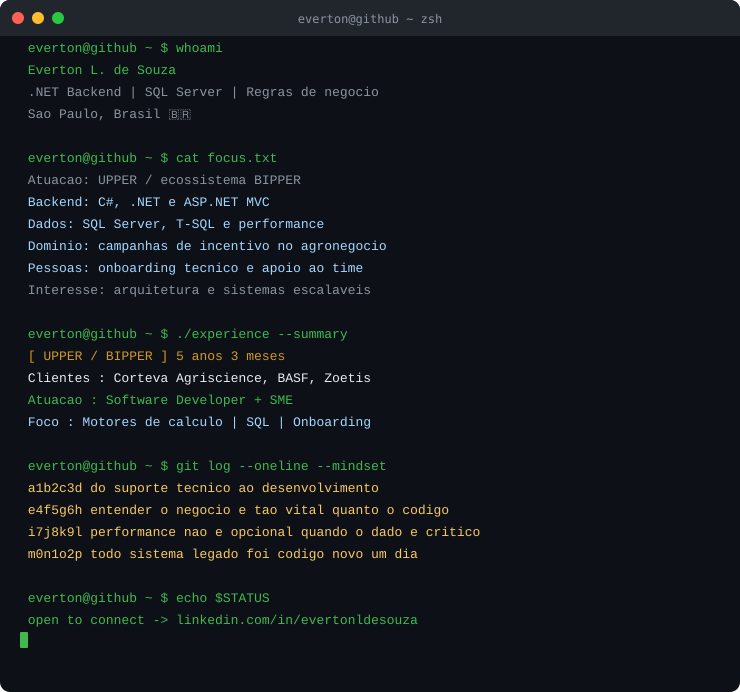

  

<h1 align="center">Olá, eu sou o Everton 👋</h1>

  <strong>Desenvolvedor Backend .NET</strong> · C# · SQL Server · Regras de negócio

  
  
  

---

## `01` &nbsp; Do suporte ao core

Comecei em suporte técnico e migrei para desenvolvimento em 2022. Conhecer os desafios de quem usa o sistema me ajuda a conectar decisões técnicas às necessidades do negócio.

Hoje atuo na **UPPER**, no ecossistema **BIPPER**, desenvolvendo e otimizando motores de cálculo para campanhas de incentivo no agronegócio. Trabalho com **C#, ASP.NET MVC e SQL Server**, com atenção à integridade dos dados e à continuidade de sistemas críticos.

- **Regras e dados** · Modelagem de regras de negócio, T-SQL, stored procedures e otimização de consultas.
- **Sistemas que evoluem** · Refatoração de código legado, APIs e práticas de Clean Architecture e SOLID.
- **Pessoas e domínio** · Atuação como SME, apoiando decisões técnicas e o onboarding de desenvolvedores.
- **Formação** · Bacharelado em Tecnologia da Informação na UNIVESP, em andamento (2025–2028).

> Entender o problema de negócio é tão importante quanto escrever o código.

## `02` &nbsp; Projetos em destaque

Projetos que exploram arquitetura, dados e soluções para problemas reais. Mais detalhes e demonstrações no [portfólio](https://evertonldesouza.pages.dev/#projects).

### 🌾 [AgroData Engine](https://github.com/evertonldesouza/AgroData_Engine)
Inteligência de dados para o agronegócio: coleta e processamento de preços de commodities, API e dashboard para apoiar decisões.

`C#` `Python` `PostgreSQL` `Docker` · [Ver projeto](https://github.com/evertonldesouza/AgroData_Engine) · [Demo](https://evertonldesouza.github.io/AgroData_Engine/)

### 🔎 [JobRadar](https://github.com/evertonldesouza/JobRadar)
Agregador de vagas de tecnologia com API REST, autenticação JWT e login com Google.

`C#` `.NET` `PostgreSQL` `JWT` · [Ver projeto](https://github.com/evertonldesouza/JobRadar) · [Demo](https://evertonldesouza.github.io/JobRadar/)

### 📚 [Hub de Grupos de Estudo](https://github.com/evertonldesouza/hub-grupos-estudo)
Comunidade de aprendizagem para criar trilhas, acompanhar o progresso e trocar conhecimento.

`C#` `.NET` `Clean Architecture` `PostgreSQL` · [Ver projeto](https://github.com/evertonldesouza/hub-grupos-estudo)

### 📈 [TrendBot](https://github.com/evertonldesouza/TrendBot)
Projeto em Python para análise quantitativa, risco e dados do mercado de criptoativos.

`Python` `Análise de dados` · [Ver projeto](https://github.com/evertonldesouza/TrendBot)

## `03` &nbsp; Tecnologias e práticas

**Backend e dados** 

**Ferramentas e interfaces** 

`ASP.NET MVC` · `T-SQL` · `Clean Architecture` · `SOLID` · `CQRS` · `Code review`

## `04` &nbsp; Um pouco mais sobre mim

💻 Abrir o terminal

 

  

Desenvolvedor .NET e SME na UPPER, com experiência em motores de cálculo, otimização SQL e onboarding técnico. Na empresa desde agosto de 2021.

<!-- O tempo na UPPER exibido no terminal é calculado desde agosto de 2021.
     Para mudar a data, edite scripts/update_experience.py; se o vínculo terminar,
     desative o workflow .github/workflows/update-experience.yml e atualize o SVG. -->

🐍 Ver animação de contribuições

 

  <picture>
    <source media="(prefers-color-scheme: dark)" srcset="https://raw.githubusercontent.com/evertonldesouza/evertonldesouza/output/github-contribution-grid-snake-dark.svg" />
    <source media="(prefers-color-scheme: light)" srcset="https://raw.githubusercontent.com/evertonldesouza/evertonldesouza/output/github-contribution-grid-snake.svg" />
    
  </picture>

---

  <strong>Vamos conversar?</strong> 
  <a href="https://evertonldesouza.pages.dev/">Portfólio</a> ·
  <a href="https://www.linkedin.com/in/evertonldesouza/">LinkedIn</a> ·
  <a href="mailto:evertonldesouza@proton.me">E-mail</a>

